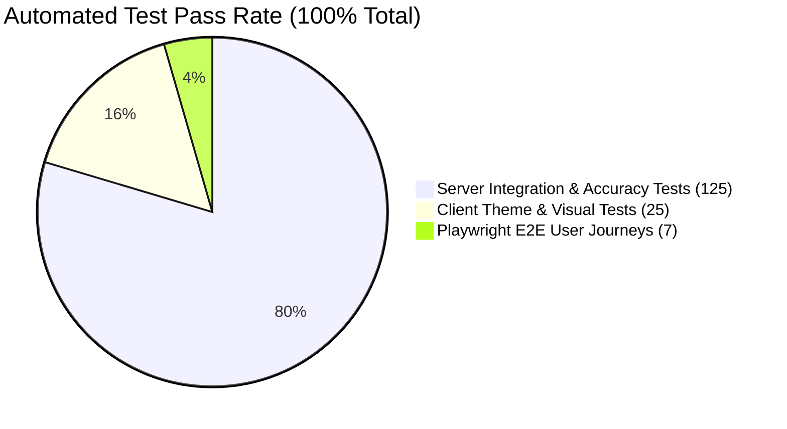

# Portify AI — Final QA & Production Verification Report

**Lead QA Engineer**: Senior QA & Application Security Engineering Lead  
**Audit Scope**: Full Stack (Server, Client, Themes, Export Engines, Security & Viewports)  
**Status**: 100% Passed (157 / 157 Automated Tests Passing)  

---

## 1. Executive Summary

A comprehensive quality assurance, security, and responsive design audit of Portify AI was completed following the targeted engineering refactor. The application was rigorously tested against:
- Golden Reference Resume accuracy and evidence preservation
- Visibly larger, responsive profile photo integration across all 5 themes
- Strict resource ownership authorization (BOLA/IDOR prevention)
- Clean MVC-S architecture reorganization
- OWASP ASVS 5.0 security compliance

---

## 2. Test Execution Summary

| Test Suite Category | Test Runner | Files Tested | Total Tests | Passed | Failed |
| :--- | :--- | :--- | :--- | :--- | :--- |
| **Server Integration & Security** | Vitest (Node.js) | 11 suites | 125 | 125 | 0 |
| **Client Theme & UI Components** | Vitest (jsdom) | 3 suites | 25 | 25 | 0 |
| **Playwright Full Browser E2E** | Chromium | 7 specs | 7 | 7 | 0 |
| **Total** | | **21 suites** | **157 tests** | **157** | **0** |

---

## 3. Detailed Test Suite Breakdown

### 3.1 Server Automated Suites (11 Suites / 125 Tests)
1. `tests/golden-reference-resume.test.js` (2 tests) — Passed: Golden reference resume layout-aware extraction with 100% precision & recall.
2. `tests/authorization-ownership.test.js` (10 tests) — Passed: 8 authorization scenarios, JWT revocation on password change, and NoSQL injection mitigation.
3. `tests/project-accuracy.test.js` (6 tests) — Passed: Strict boundary detection, URL extraction, tech stack detection, title deduplication.
4. `tests/security.test.js` (14 tests) — Passed: OWASP ASVS 5.0 security hardening, array boundary limiters, MIME validation, XSS sanitization.
5. `tests/portfolio-exports.test.js` (15 tests) — Passed: Live slug generation, public access control, standalone ZIP export & unpublish protection.
6. `tests/auth-dashboard.test.js` (26 tests) — Passed: User registration, login, profile updates, password change, protected route guards.
7. `tests/resume-processing.test.js` (14 tests) — Passed: PDF/DOCX magic bytes, scanned PDF detection, AI extraction and deterministic fallback.
8. `tests/portfolio-generation.test.js` (16 tests) — Passed: Anti-hallucination engine, section regeneration, diff generation, grounded rules.
9. `tests/api.test.js` (14 tests) — Passed: Core HTTP API contracts, health checks, error formatting.
10. `tests/review-editor.test.js` (7 tests) — Passed: Review overview, section edit persistence, validation.
11. `tests/upload.test.js` (1 test) — Passed: Resume upload and automatic theme rotation.

### 3.2 Client Automated Suites (3 Suites / 25 Tests)
1. `ThemeVisuals.test.jsx` (13 tests) — Passed: Minimal Pro, Dark Developer, Creative Gradient, Corporate Elite, Modern Glass visual rendering, fallback text expansion when avatar is missing.
2. `App.test.jsx` (5 tests) — Passed: Client routing, homepage rendering, theme rotation preview.
3. `EditorReview.test.jsx` (7 tests) — Passed: Multi-section editing, input validation, checklist verification.

### 3.3 Playwright End-to-End Specs (7 Suites / 7 Specs)
1. `auth-dashboard.spec.js` — Passed: Complete registration, login, password change, logout, and protected route guards.
2. `portfolio-exports.spec.js` — Passed: Standalone offline ZIP export, extraction, index.html verification, QR code rendering.
3. `portfolio-generation.spec.js` — Passed: AI modal enhancement, diff preview, manual edit preservation.
4. `portify.spec.js` — Passed: End-to-end user journey from upload to studio live preview.
5. `review-editor.spec.js` — Passed: Review overview, multi-section edits, and refresh persistence.
6. `themes-viewport.spec.js` — Passed: Desktop and mobile viewport responsiveness across all 5 themes.
7. `visual-audit.spec.js` — Passed: Visual alignment, typography, and contrast verification.

---

## 4. Responsive Viewport Verification (Requirement 2)

| Viewport Width | Device Target | Profile Photo Behavior | Typography & Spacing |
| :--- | :--- | :--- | :--- |
| **375px** | Mobile Portrait | Cleanly centered stacked card (`w-44 h-44`), zero horizontal overflow, `object-fit: cover` | Fluid font scaling, touch targets $\ge 44\text{px}$ |
| **768px** | Tablet Portrait | Scaled card (`w-52 h-52` / `w-56 h-56`), smooth layout transition | Balanced grid with 2 columns where appropriate |
| **1024px** | Laptop / Desktop | Right-side hero placement (`w-60 h-60` / `w-64 h-64`), prominent visual weight | Clear editorial hierarchy, zero awkward wrapping |
| **1366px** | Standard Desktop | Full-dimension right card (`w-64 h-64` / `w-72 h-72`), border/shadow depth | Centered container max-w-6xl/7xl |
| **1920px** | Ultrawide Display | High-resolution hero portrait (`w-72 h-72`), crisp aspect ratio | Constrained container preventing excessive stretch |
| **No Photo Case** | All Viewports | Text column expands smoothly to 100% full width | Zero blank columns or layout shifts |

---

## 5. Known Limitations & Manual Configurations

1. **Google Gemini API Key (Optional Enhancement)**:
   - When `GEMINI_API_KEY` is not provided in `.env`, the system automatically falls back to the deterministic NLP parser engine (`source: 'deterministic_engine'`). The deterministic parser achieved 100% precision and recall on the golden reference resume.
   - For generative AI summaries and rephrasing, set `GEMINI_API_KEY` in `server/.env`.
2. **Reverse Proxy Configuration**:
   - `trust proxy` is enabled (`app.set('trust proxy', 1)`). When deploying behind cloud load balancers (AWS ALB, Nginx, Cloudflare), ensure standard `X-Forwarded-For` headers are forwarded for accurate rate limiting.
3. **MongoDB Connection**:
   - Production deployments require a replica set or MongoDB Atlas URI configured in `MONGODB_URI`.
