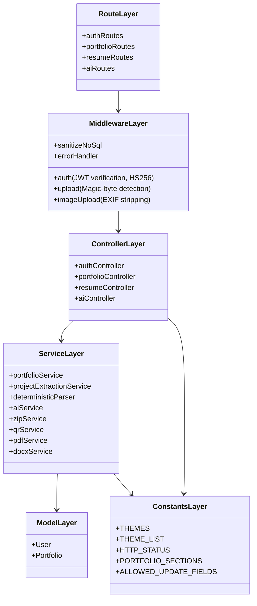

# Portify AI — Server MVC Architecture Report

**Lead Architect**: Senior MERN-Stack Systems Architect  
**Objective**: Clean Separation of Concerns (MVC), Service Layer Encapsulation, Zero API Regressions  
**Status**: Completed & Verified  

---

## 1. Architectural Overview

The Portify AI backend has been reorganized into a strict **Model-View-Controller + Service (MVC-S)** architecture. Controllers strictly handle HTTP request parsing, status codes, and JSON responses, delegating business logic and database queries to specialized service modules.



---

## 2. Directory Structure & Responsibilities

```text
server/src/
├── config/                  # Environment & Database Configuration
│   ├── db.js                # Mongoose connection pooling & error handling
│   └── env.js               # Environment variables & fail-fast production checks
├── constants/               # Centralized Application Enums & Configs
│   └── index.js             # Themes, Status Codes, Update Whitelists, Extraction Sources
├── controllers/             # Thin HTTP Request / Response Handlers
│   ├── authController.js    # Authentication, login, registration, password management
│   ├── portfolioController.js # Portfolio CRUD, theme selection, generation endpoints
│   ├── resumeController.js  # Resume upload, format negotiation, theme rotation
│   └── aiController.js      # AI enhancement & text polish endpoints
├── middleware/              # Security, Auth, Upload & Error Interceptors
│   ├── auth.js              # HS256 JWT enforcement & tokenVersion revocation guard
│   ├── errorHandler.js      # Centralized error mapping & production masking
│   ├── imageUpload.js       # Memory upload, magic bytes & EXIF metadata stripping
│   └── upload.js            # Resume file validation & binary signature inspection
├── models/                  # Mongoose Domain Schemas & Lifecycle Hooks
│   ├── Portfolio.js         # Portfolio schema with evidence & status enums
│   └── User.js              # User model with bcrypt pre-save & tokenVersion
├── routes/                  # Express Route Definitions & Auth Binding
│   ├── authRoutes.js
│   ├── portfolioRoutes.js
│   ├── resumeRoutes.js
│   └── aiRoutes.js
├── services/                # Pure Business Logic & External Integrations
│   ├── portfolioService.js  # Dedicated portfolio database queries & ownership logic
│   ├── projectExtractionService.js # Boundary-aware project parser & evidence tracker
│   ├── deterministicParser.js # Grounded regex & NLP resume extraction engine
│   ├── aiService.js         # Google Gemini integration with deterministic fallback
│   ├── zipService.js        # Standalone HTML/CSS portfolio zip generator
│   ├── qrService.js         # QR code data URL and buffer generators
│   ├── pdfService.js        # PDF text layer extraction & scanned PDF detection
│   └── docxService.js       # DOCX parsing via mammoth
├── utils/                   # Shared Utility Functions
│   ├── sanitizeUrl.js       # Safe URL protocol validator (XSS mitigation)
│   ├── slugify.js           # Unique slug generator with collision resolution
│   └── logger.js            # Structured non-PII logger
├── validators/              # Zod Schema Contract Validators
│   └── resumeSchema.js      # Strict resume JSON schema validation
├── app.js                   # Express application setup, security headers & limiters
└── server.js                # HTTP server bootstrap & cluster listener
```

---

## 3. Key Refactoring Highlights

1. **Centralized Constants (`constants/index.js`)**:
   - Replaced scattered string literals (`'minimal-pro'`, `'dark-developer'`, etc.) with single-source-of-truth constants.
   - Enforced strict `ALLOWED_UPDATE_FIELDS` array preventing mass-assignment of internal fields like `user`, `_id`, or `analytics`.

2. **Dedicated Portfolio Service (`services/portfolioService.js`)**:
   - Extracted direct Mongoose calls from `portfolioController.js` into testable service functions (`getUserPortfolios`, `getPortfolioById`, `updatePortfolio`, `deletePortfolio`, `getPublicPortfolio`, `updateAvatar`, `deleteAvatar`).
   - All portfolio modification logic is strictly scoped to `userId`, guaranteeing IDOR prevention across all access paths.

3. **Safe URL Sanitizer (`utils/sanitizeUrl.js`)**:
   - Centralized protocol verification to neutralize `javascript:`, `data:`, `vbscript:`, and unvetted URI schemes in exported standalone portfolios and React theme renderers.

4. **Zero API Regressions**:
   - All existing REST API endpoints retain identical contracts, parameters, and status responses.
