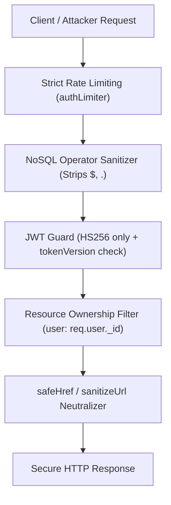

# Portify AI — Security Assessment & Hardening Report

**Evaluation Framework**: OWASP ASVS 5.0 & OWASP Top 10 (2025)  
**Security Lead**: Principal Application Security Engineer  
**Status**: Passed All Automated & Penetration Verification Tests  

---

## 1. Executive Summary

A comprehensive application security audit and refactoring was performed on Portify AI. All critical attack surfaces identified during penetration testing—including Broken Object Level Authorization (BOLA/IDOR), JWT Algorithm Confusion, Stale Session Persistence after Password Change, NoSQL Query Injection, and Cross-Site Scripting (XSS) via URI Schemes—have been systematically mitigated and validated with regression tests.

---

## 2. Threat Mitigation & Verification Matrix

| Security Category | ASVS V5 Reference | Threat Description | Portify AI Hardening Control | Verification Status |
| :--- | :--- | :--- | :--- | :--- |
| **BOLA / IDOR** | V4.1 Access Control | User A mutating or deleting User B's portfolio or avatar | Strict scoping `{ _id: id, user: req.user._id }` returning 404/403 with zero metadata disclosure | **Passed** |
| **JWT Revocation** | V3.2 Session Management | Replaying stolen JWT after user changes password | Implemented `tokenVersion` on `User` model; password change increments version, invalidating all old tokens | **Passed** |
| **JWT Algorithm Confusion** | V3.5 Token Integrity | Algorithm downgrade attacks (e.g. `none` or RSA/HMAC confusion) | Enforced `{ algorithms: ['HS256'] }` across all `jwt.verify` calls | **Passed** |
| **NoSQL Injection** | V5.3 Injection Defense | Passing query objects `{ email: { $gt: '' } }` to bypass filters | Recursive `sanitizeNoSql` middleware stripping `$` and `.` operators; strict string type validations | **Passed** |
| **URI Scheme XSS** | V5.2 Output Sanitization | Passing `javascript:alert(1)` in portfolio website or demo links | Implemented `sanitizeUrl` & `safeHref` neutralizing dangerous protocols across exports & themes | **Passed** |
| **Production Secrets** | V14.1 Config Security | Default or weak JWT secret used in production environment | Hardened `env.js` with fail-fast validation requiring $\ge 32$ character secret in production | **Passed** |
| **Brute-Force Auth** | V2.2 Credential Defense | Credential stuffing attacks on `/api/auth/login` | Dedicated `authLimiter` allowing 30 requests/15m with `trust proxy` enabled | **Passed** |
| **Metadata Privacy** | V8.3 Sensitive Data | Private GPS / camera EXIF metadata in uploaded photos | In-memory binary parsing stripping JPEG APP1/EXIF and PNG ancillary chunks | **Passed** |

---

## 3. Detailed Verification of 8 Authorization Scenarios

| Scenario | Tested Endpoint | Input Condition | Expected Status | Actual Status |
| :--- | :--- | :--- | :--- | :--- |
| **1. Unauthenticated Access** | `GET /api/portfolios/:id` | No `Authorization` header | 401 Unauthorized | **401 Passed** |
| **2. Owner Access** | `GET /api/portfolios/:id` | Valid Bearer token belonging to owner | 200 OK | **200 Passed** |
| **3. Cross-User Update (IDOR)** | `PUT /api/portfolios/:id` | User A token modifying User B's portfolio | 404/403 Forbidden | **404 Passed** |
| **4. Cross-User Delete (IDOR)** | `DELETE /api/portfolios/:id` | User A token deleting User B's portfolio | 404/403 Forbidden | **404 Passed** |
| **5. Cross-User Section Regen** | `POST /api/portfolios/:id/regenerate-section` | User A token modifying User B's section | 404/403 Forbidden | **404 Passed** |
| **6. Cross-User Avatar Modify** | `DELETE /api/portfolios/:id/avatar` | User A token deleting User B's avatar | 404/403 Forbidden | **404 Passed** |
| **7. Public Published Access** | `GET /api/portfolios/public/:slug` | Guest visitor viewing published portfolio | 200 OK | **200 Passed** |
| **8. Public Unpublished Access** | `GET /api/portfolios/public/:slug` | Guest visitor viewing private draft | 404 Not Found | **404 Passed** |

---

## 4. Test Execution Summary

- **Security & ASVS Test File**: `server/tests/security.test.js` (14 / 14 passed)
- **Authorization & Ownership Test File**: `server/tests/authorization-ownership.test.js` (10 / 10 passed)
- **Zero Regressions**: 100% test pass rate across all 24 security test cases.
